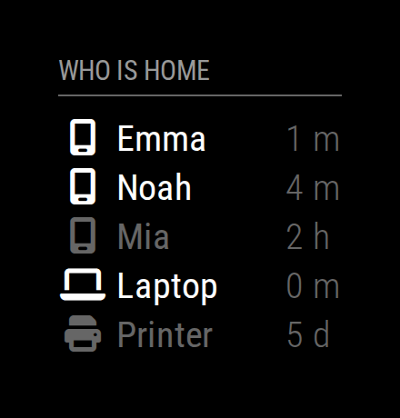
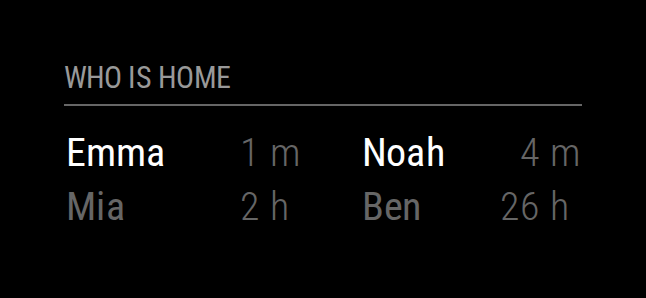

# MMM-NetworkScanner

A [MagicMirror²](https://magicmirror.builders) module that shows which devices are on your network, e.g. whose phone is at home.



## Features

- Phones and other devices by their MAC address, found with [arp-scan](https://github.com/royhills/arp-scan), and servers by their IP address or host name, found with ping
- The time since each device was last seen, e.g. `5 m`, `2 h` or `4 d`, also after a restart of MagicMirror²
- A list or several columns, with Font Awesome icons in the colors of your choice
- Notifications when the first resident comes home and when the last one leaves, e.g. to turn the monitor on and off
- Messages on the mirror that say why the module cannot scan
- English and German

## Installation

The module requires MagicMirror² 2.38.0 or newer on Linux, e.g. Raspberry Pi OS. Install arp-scan, allow it to scan the network without sudo, and clone the module into the `modules` directory of MagicMirror²:

```shell
sudo apt install arp-scan
sudo setcap cap_net_raw+ep /usr/sbin/arp-scan
cd ~/MagicMirror/modules
git clone https://github.com/ms-zone-41/MMM-NetworkScanner
```

Only devices with a `macAddress` need arp-scan: if all your devices have an `ipAddress`, skip the first two commands. The module has no dependencies to install with npm. Add it to your configuration, see below, and restart MagicMirror².

## Update

```shell
cd ~/MagicMirror/modules/MMM-NetworkScanner
git pull
```

Then restart MagicMirror². To update from version 1, see [Upgrading from version 1](#upgrading-from-version-1).

## Configuration

Add the module to the `modules` array in `config/config.js`, with your devices. This example shows the list in the screenshot above: three phones and a laptop by their MAC address, and a printer by its IP address:

```js
	{
		module: "MMM-NetworkScanner",
		position: "top_left",
		header: "Who is home",
		config: {
			devices: [
				{ macAddress: "aa:bb:cc:dd:ee:01", name: "Emma", icon: "mobile-screen" },
				{ macAddress: "aa:bb:cc:dd:ee:02", name: "Noah", icon: "mobile-screen" },
				{ macAddress: "aa:bb:cc:dd:ee:03", name: "Mia", icon: "mobile-screen" },
				{ macAddress: "aa:bb:cc:dd:ee:04", name: "Laptop", icon: "laptop" },
				{ ipAddress: "192.168.178.10", name: "Printer", icon: "print" }
			],
			showLastSeen: true
		}
	},
```

To find the MAC address of a phone, see [Finding the MAC address of a device](#finding-the-mac-address-of-a-device).

### Options

| Option | Description | Default |
| --- | --- | --- |
| `devices` | The devices to show, in this order, see [Devices](#devices). | Required |
| `network` | The network that arp-scan scans, in CIDR notation, e.g. `"192.168.178.0/24"`. Set it if your network is too large to scan within 30 seconds. | The local network of `interface` |
| `interface` | The network interface that arp-scan uses, e.g. `"wlan0"`. Set it if the mirror is connected to more than one network, e.g. by Ethernet and Wi-Fi. | The first connected interface |
| `updateInterval` | The time between two scans, in seconds, at most 3600. | `60` |
| `keepAlive` | How long a device counts as online after it last answered, in seconds, at most 86400. | `300` |
| `showOffline` | Also show the devices that are offline, dimmed. | `true` |
| `showLastSeen` | Show the time since each device last answered, or `-` if it never has: `true` for all devices, `"offline"` only for the devices that are offline. | `false` |
| `columns` | The number of devices in a row. `1` shows a list. | `1` |
| `residents` | The `name`s of the devices that tell whether someone is at home, e.g. phones. | `[]` |
| `occupiedCMD` | The notification to send when the first resident comes home, as `{ notification: "…", payload: … }`. | `null` |
| `vacantCMD` | The notification to send when the last resident has left, like `occupiedCMD`. | `null` |

If you add the module more than once, every entry shows the devices of the first one.

### Devices

Each device in `devices` has either a `macAddress` or an `ipAddress`:

| Key | Description |
| --- | --- |
| `macAddress` | The MAC address of the device, with colons, e.g. `"aa:bb:cc:dd:ee:01"`. |
| `ipAddress` | The IPv4 address of the device, e.g. `"192.168.178.10"`, which the module pings. Give the device a fixed address in your router. A host name works only if it resolves while the device is off, so not a `.local` name. |
| `name` | The name to show. By default the address. |
| `icon` | The name of a [Font Awesome](https://fontawesome.com/icons) icon of the free solid style, without `fa-`, e.g. `"mobile-screen"`. No icon by default. |
| `color` | The color of the icon while the device is online, as in CSS, e.g. `"orange"` or `"#ff0000"`. By default, and while the device is offline or the scan fails, the color of the name. |

The names have the class `ns-online` or `ns-offline`, and the table has the class `ns-stale` while the scan fails, so `config/custom.css` can style them, e.g. to show the devices that are offline in red:

```css
.MMM-NetworkScanner .ns-offline {
  color: #ff6666;
}
```

### Examples

Four phones in two columns:



```js
	{
		module: "MMM-NetworkScanner",
		position: "top_left",
		header: "Who is home",
		config: {
			devices: [
				{ macAddress: "aa:bb:cc:dd:ee:01", name: "Emma" },
				{ macAddress: "aa:bb:cc:dd:ee:02", name: "Noah" },
				{ macAddress: "aa:bb:cc:dd:ee:03", name: "Mia" },
				{ macAddress: "aa:bb:cc:dd:ee:04", name: "Ben" }
			],
			showLastSeen: true,
			columns: 2
		}
	},
```

The monitor on while someone is at home, with the module [MMM-Remote-Control](https://github.com/Jopyth/MMM-Remote-Control), which turns it on and off for the notification `REMOTE_ACTION`:

```js
	{
		module: "MMM-NetworkScanner",
		position: "top_left",
		config: {
			devices: [
				{ macAddress: "aa:bb:cc:dd:ee:01", name: "Emma", icon: "mobile-screen" },
				{ macAddress: "aa:bb:cc:dd:ee:02", name: "Noah", icon: "mobile-screen" }
			],
			residents: ["Emma", "Noah"],
			occupiedCMD: { notification: "REMOTE_ACTION", payload: { action: "MONITORON" } },
			vacantCMD: { notification: "REMOTE_ACTION", payload: { action: "MONITOROFF" } }
		}
	},
```

When the module starts, it also sends `occupiedCMD` if a resident is at home, and `vacantCMD` if not.

### Finding the MAC address of a device

Phones use a private Wi-Fi address, a MAC address of their own for each network. Take it from the Wi-Fi settings of the phone, not from its About screen, which shows the hardware address:

- iPhone: Settings › Wi-Fi › (i) next to your network shows it as Wi-Fi Address. Set Private Wi-Fi Address to Fixed there, as Rotating changes the address about every two weeks.
- Android: the details of your network in the Wi-Fi settings show it. By default, it stays the same for the network.

For other devices, run arp-scan as the user that runs MagicMirror², without sudo, which also checks that the module can scan. It lists the devices on your network with their IP address, their MAC address and the maker of their network card:

```shell
/usr/sbin/arp-scan --localnet --plain
```

```text
192.168.178.1	e0:28:6d:00:00:01	AVM Audiovisuelles Marketing und Computersysteme GmbH
192.168.178.20	aa:bb:cc:dd:ee:01	(Unknown: locally administered)
192.168.178.21	aa:bb:cc:dd:ee:02	(Unknown: locally administered)
```

Private Wi-Fi addresses show as "locally administered". To tell which line is which device, compare the IP addresses with the device list of your router.

## Troubleshooting

If the module cannot scan, it says why above the devices, and below that the command that solves the problem or what went wrong. The log of MagicMirror² says the same. Until a scan works again, the module shows all devices dimmed, as it cannot tell who is online, and sends no `occupiedCMD` or `vacantCMD`.

| Message | What to do |
| --- | --- |
| arp-scan is not installed | Run the first two commands of [Installation](#installation). |
| arp-scan is not allowed to scan the network | Run `sudo setcap cap_net_raw+ep /usr/sbin/arp-scan`. An update of arp-scan removes the capability, so run it again after one. |
| The network scan failed | Check `network`, `interface` and the addresses of the devices; a host name must always resolve, see [Devices](#devices). To see the whole error, run the command in a terminal, e.g. `/usr/sbin/arp-scan --interface=wlan0 --localnet` or `ping -c 1 192.168.178.10`. |
| The option … is not valid | Correct the value shown below the message in `config/config.js`, see [Options](#options), and restart MagicMirror². |

If the module does not show at all, MagicMirror² may be older than 2.38.0: its log then says "Version is incorrect. Skip module: 'MMM-NetworkScanner'". [Upgrade MagicMirror²](https://docs.magicmirror.builders/getting-started/upgrade-guide.html).

If a device stays offline although it is at home:

- Run `/usr/sbin/arp-scan --localnet --plain` while the device is on. If its MAC address is missing, the device uses another one, e.g. a new private Wi-Fi address after the phone forgot your network, or the mirror scans another network: then set `interface`.
- A device that does not answer ping, e.g. a Windows PC, needs a `macAddress` instead of an `ipAddress`.
- If a phone goes offline now and then while it is at home, raise `keepAlive`.

## Upgrading from version 1

Version 2 is a rewrite with a new configuration, and only this repository has it. To upgrade:

1. [Upgrade MagicMirror²](https://docs.magicmirror.builders/getting-started/upgrade-guide.html) to 2.38.0 or newer.
2. Replace the module with a new clone, and allow arp-scan to scan without sudo:

   ```shell
   cd ~/MagicMirror/modules
   rm -rf MMM-NetworkScanner
   git clone https://github.com/ms-zone-41/MMM-NetworkScanner
   sudo setcap cap_net_raw+ep /usr/sbin/arp-scan
   ```

3. Do not keep the entry of version 1 disabled in `config/config.js`: the module takes its devices from the first `MMM-NetworkScanner` entry, even a disabled one.
4. Replace the options that are gone, see the table below. Brand icons, e.g. `apple`, and outline icons whose names end in `-o`, e.g. `hdd-o`, no longer show: use solid icons, e.g. `mobile-screen` or `hard-drive`.
5. Restart MagicMirror².

| Option of version 1 | In version 2 |
| --- | --- |
| `showUnknown` | Gone, see [Finding the MAC address of a device](#finding-the-mac-address-of-a-device). |
| `sort` | Gone: the devices appear in the order of `devices`. |
| `debug` | Add `"DEBUG"` to the `logLevel` of MagicMirror². |
| `colored`, `coloredSymbolOnly`, `coloredState`, and `colorStateOnline` and `colorStateOffline` of the devices | The `color` of each device, and `config/custom.css`, see [Devices](#devices). |
| `showDeviceColumns`, and `showInNewRow` of the devices | `columns` |
| `showLastSeenWhenOffline` | `showLastSeen: "offline"` |
| `showOffline` of the devices | `showOffline` |
| `network: "-l"` | Leave out `network`. |

## Development

The tests use [node:test](https://nodejs.org/api/test.html) and the development dependencies of the module. Run them and [ESLint](https://eslint.org) in the module directory:

```shell
npm install
node --run test
node --run lint
```

GitHub runs both for every push and pull request.

## Changelog

See [CHANGELOG.md](CHANGELOG.md).

## License

MIT, see [LICENSE](LICENSE). [Ian Perrin](https://github.com/ianperrin/MMM-NetworkScanner) wrote the module. [spitzlbergerj](https://github.com/spitzlbergerj/MMM-NetworkScanner) and [nsprawling](https://github.com/nsprawling/MMM-NetworkScanner) maintained forks of it, which this one continues.
